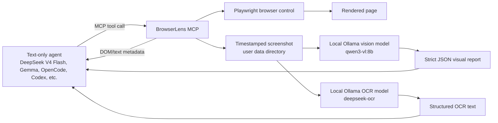
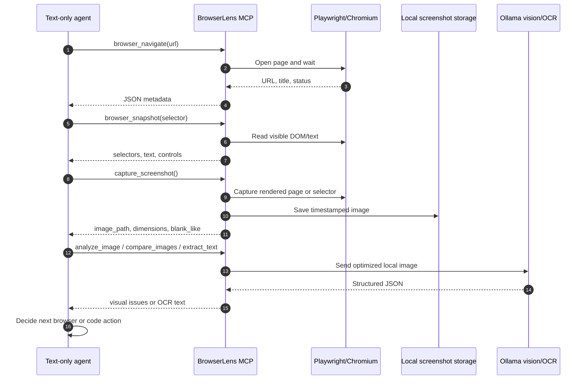
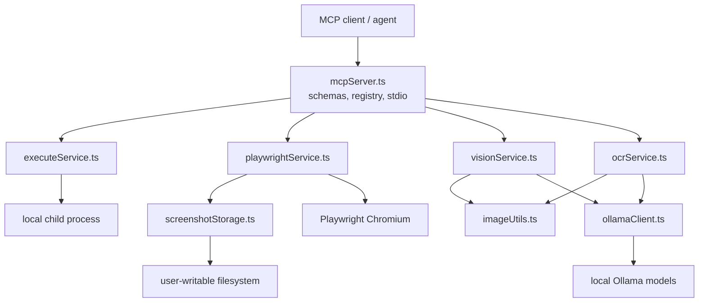

# BrowserLens

BrowserLens is a production-oriented Model Context Protocol server that gives text-only AI agents browser control and local visual understanding.

It solves a practical gap: strong coding agents are often fast and cheap when used as text-only models, but they cannot see the browser they are controlling. BrowserLens lets those agents navigate pages, inspect DOM, take timestamped screenshots, compare rendered images, and extract text from images through local Ollama models. The main agent receives compact JSON, not raw image payloads, which keeps token usage low and allows non-multimodal models to work on visual browser tasks.

This project has been tested successfully in workflows where a fast text-only model, such as **DeepSeek V4 Flash** or the local Gemma setup used during development, acts as the main agent and BrowserLens delegates visual interpretation to local Ollama models.

It provides:

- local command execution with bounded timeouts
- Playwright navigation, DOM snapshots, clicks, input, key presses, waits, and page evaluation
- timestamped browser screenshots stored in user-writable per-project directories
- visual analysis and image comparison through Ollama multimodal models
- OCR through Ollama

BrowserLens is a capability layer only. It does not include autonomous loops or agent reasoning.

## Problem It Solves

Browser automation alone can tell an agent what the DOM says, but not whether the page actually looks right. A rendered UI can be broken while the DOM appears reasonable: wrong crop, missing image, bad spacing, invisible text, overlapped controls, blank canvas, iframe timing issues, or layout drift.

Multimodal cloud models can inspect screenshots, but they can be expensive, slower, or unavailable in privacy-sensitive local workflows. BrowserLens keeps the expensive visual context local:

- the main agent can be text-only, such as DeepSeek V4 Flash
- screenshots stay on disk and are passed by file path
- local vision/OCR models return structured JSON summaries
- the main model spends tokens on decisions, not image bytes

## How It Works



The important design choice is that screenshots are never returned as MCP image bytes. BrowserLens returns local paths and structured JSON so text-only models can reason about visual state without becoming multimodal themselves.

## Recommended Model Setup

There are two model roles:

- Main agent: **DeepSeek V4 Flash**, Gemma, or another strong text-only coding model
- Browser control: BrowserLens through MCP
- Visual analysis: a local Qwen vision model through Ollama
- OCR: a local OCR model through Ollama

The package defaults are:

| Role | Environment variable | Default |
| --- | --- | --- |
| Ollama endpoint | `OLLAMA_BASE_URL` | `http://localhost:11434` |
| Visual analysis/comparison | `VISION_MODEL` | `qwen3-vl:8b` |
| OCR | `OCR_MODEL` | `deepseek-ocr` |

The development setup that has worked well is:

| Role | Recommended model |
| --- | --- |
| Main text-only agent | DeepSeek V4 Flash or your local Gemma setup |
| Vision/comparison | Qwen vision variant configured in `VISION_MODEL` |
| OCR | `deepseek-ocr` |

Default environment:

```bash
OLLAMA_BASE_URL=http://localhost:11434
VISION_MODEL=qwen3-vl:8b
OCR_MODEL=deepseek-ocr
```

Pull the local models before using the visual tools:

```bash
ollama pull qwen3-vl:8b
ollama pull deepseek-ocr
```

If your tested Qwen or Gemma tags differ from the defaults, set them in the MCP client environment instead of changing code. For example:

```bash
VISION_MODEL=<your-qwen-vision-tag>
OCR_MODEL=deepseek-ocr
```

## Requirements

- Node.js 20+
- npm
- Ollama running on `http://localhost:11434`
- Ollama models:
  - `qwen3-vl:8b`
  - `deepseek-ocr`
- Playwright Chromium browser installed

## Installation

```bash
npm install
npx playwright install chromium
npm run build
```

Run the MCP server:

```bash
npm start
```

For local development:

```bash
npm run dev
```

## MCP Configuration

Point your MCP client at the built stdio server. Configure the local Ollama endpoint and models in the MCP entry so each user can choose their own local setup without changing BrowserLens code:

```json
{
  "mcp": {
    "browserlens": {
      "command": "node",
      "args": ["/absolute/path/to/browserlens/dist/mcpServer.js"],
      "env": {
        "OLLAMA_BASE_URL": "http://localhost:11434",
        "VISION_MODEL": "qwen3-vl:8b",
        "OCR_MODEL": "deepseek-ocr",
        "BROWSERLENS_SCREENSHOT_DIR": "/custom/writable/path"
      }
    }
  }
}
```

### OpenCode Example

For OpenCode, put the local model configuration in the MCP server entry. The exact file location depends on your OpenCode setup, but the important part is the `env` block:

```json
{
  "mcp": {
    "browserlens": {
      "command": "node",
      "args": ["/absolute/path/to/browserlens/dist/mcpServer.js"],
      "env": {
        "OLLAMA_BASE_URL": "http://localhost:11434",
        "VISION_MODEL": "qwen3-vl:8b",
        "OCR_MODEL": "deepseek-ocr"
      }
    }
  }
}
```

If you are using another tested local model, change only the values:

```json
{
  "mcp": {
    "browserlens": {
      "command": "node",
      "args": ["/absolute/path/to/browserlens/dist/mcpServer.js"],
      "env": {
        "OLLAMA_BASE_URL": "http://localhost:11434",
        "VISION_MODEL": "your-local-qwen-vision-model",
        "OCR_MODEL": "your-local-ocr-model"
      }
    }
  }
}
```

After publishing to npm, clients can also run the package binary:

```json
{
  "mcp": {
    "browserlens": {
      "command": "npx",
      "args": ["browserlens"],
      "env": {
        "OLLAMA_BASE_URL": "http://localhost:11434",
        "VISION_MODEL": "qwen3-vl:8b",
        "OCR_MODEL": "deepseek-ocr"
      }
    }
  }
}
```

The main agent model is configured in your MCP client or agent runtime, not in BrowserLens. BrowserLens only needs the local models it calls directly: one visual model for `analyze_image` and `compare_images`, and one OCR model for `extract_text`.

This pattern also applies to other MCP clients that support environment variables for MCP servers:

```json
{
  "mcp": {
    "browserlens": {
      "command": "npx",
      "args": ["browserlens"],
      "env": {
        "OLLAMA_BASE_URL": "http://localhost:11434",
        "VISION_MODEL": "your-qwen-vision-tag",
        "OCR_MODEL": "your-ocr-model-tag"
      }
    }
  }
}
```

## Configuration

```bash
OLLAMA_BASE_URL=http://localhost:11434
VISION_MODEL=qwen3-vl:8b
OCR_MODEL=deepseek-ocr
BROWSERLENS_SCREENSHOT_DIR=/custom/writable/path
```

By default, screenshots are written to an operating-system user data directory and grouped by project name:

- macOS: `~/Library/Application Support/browserlens/screenshots/<project>/`
- Windows: `%LOCALAPPDATA%/browserlens/screenshots/<project>/`
- Linux: `${XDG_DATA_HOME:-~/.local/share}/browserlens/screenshots/<project>/`

Screenshot filenames include the capture timestamp, for example `screenshot-2026-05-30T14-18-09-123Z.jpg`, so repeated captures do not overwrite each other. If `output_path` is supplied, BrowserLens respects it; relative paths are resolved from the MCP process working directory.

## Recommended Workflow

Use BrowserLens as a loop: inspect the page cheaply as text, capture what is actually rendered, ask local vision/OCR only when needed, then make the main agent decide the next code or browser action.



For visual parity tasks:

```text
1. browser_navigate to the reference page.
2. capture_screenshot to get reference_image_path.
3. browser_navigate to the candidate page.
4. capture_screenshot to get candidate_image_path.
5. compare_images with concrete expectations and tolerance rules.
6. Use the returned JSON issues to decide what to change.
```

For UI debugging tasks:

```text
1. browser_navigate to the page under test.
2. browser_snapshot to inspect controls, text, selectors, and state.
3. browser_click/browser_fill/browser_press_key/browser_wait_for as needed.
4. capture_screenshot to verify the rendered result.
5. analyze_image or extract_text if the main model needs visual confirmation.
```

## Tools

### `execute_code`

Runs a local executable with arguments and returns stdout/stderr.

```json
{
  "command": "node",
  "args": ["./scripts/check-ui.mjs"],
  "cwd": "/path/to/project",
  "timeout_ms": 60000
}
```

Shell-style command strings are supported when `args` is omitted:

```json
{
  "command": "node -e \"console.log('ok')\"",
  "timeout_ms": 10000
}
```

### Browser Tools

These wrap Playwright and return text/JSON only:

- `browser_navigate`
- `browser_snapshot`
- `browser_click`
- `browser_fill`
- `browser_press_key`
- `browser_wait_for`
- `browser_evaluate`

Example:

```json
{
  "url": "http://localhost:3000",
  "wait_until": "networkidle",
  "viewport": {
    "width": 1440,
    "height": 1000
  }
}
```

Use `browser_snapshot` for DOM, text, selectors, forms, and page state. Do not use it as the final source of truth for visual parity because similar DOM can render with different spacing, typography, colors, composition, or imagery.

### `capture_screenshot`

Captures a full page or selector screenshot. It returns only local file metadata, never image bytes.

```json
{
  "url": "http://localhost:3000",
  "full_page": true,
  "viewport": {
    "width": 1440,
    "height": 1000
  }
}
```

Selector capture:

```json
{
  "url": "http://localhost:3000",
  "selector": "#app",
  "delay_ms": 3000
}
```

Output:

```json
{
  "image_path": "/Users/example/Library/Application Support/browserlens/screenshots/my-project/screenshot-2026-05-30T14-18-09-123Z.jpg",
  "width": 1440,
  "height": 1000,
  "blank_like": false
}
```

If `blank_like` is `true`, recapture the correct rendered canvas/content selector, often with `delay_ms`.

### `analyze_image`

Optimizes an image to max 1024px JPEG, sends it to the configured multimodal model, and returns strict JSON.

```json
{
  "goal": "Validate that the dashboard is visually usable after the latest UI change.",
  "expectations": [
    "The page is not blank",
    "The navigation is visible",
    "Text does not overlap controls"
  ],
  "image_path": "/path/to/screenshot.jpg"
}
```

### `compare_images`

Compares a candidate screenshot against a reference screenshot. The first image is always the reference and the second is always the candidate.

```json
{
  "goal": "Verify visual parity with the reference page.",
  "expectations": [
    "Spacing, alignment, typography, colors, imagery and visible text should be equivalent",
    "Report missing, extra, clipped or overlapping elements"
  ],
  "reference_image_path": "/path/to/reference.jpg",
  "candidate_image_path": "/path/to/candidate.jpg"
}
```

`matches_expectations: false` is a successful comparison result that found differences. Only `error: true` means the tool failed.

### `extract_text`

Uses the configured OCR model and returns visible text plus structured blocks.

```json
{
  "image_path": "/path/to/screenshot.jpg"
}
```

## Architecture

BrowserLens keeps the MCP transport thin and delegates behavior to services:



```text
src/
  mcpServer.ts           MCP schemas, tool registry, stdio transport
  executeService.ts      local process execution boundary
  playwrightService.ts   browser automation boundary
  screenshotStorage.ts   screenshot path and OS storage policy
  visionService.ts       visual analysis and comparison use cases
  ocrService.ts          OCR use case
  ollamaClient.ts        Ollama HTTP adapter and model lifecycle
  imageUtils.ts          image optimization helpers
  types.ts               shared result types
```

The code follows a small clean-architecture shape: MCP adapters validate input, services own use-case behavior, and infrastructure details such as Playwright, Ollama, filesystem paths, and process execution stay behind narrow modules.

## Development

```bash
npm install
npx playwright install chromium
npm run typecheck
npm run build
```

`npm run build` performs a TypeScript compile and then bundles the MCP entrypoint with esbuild into a minified `dist/mcpServer.js`. Dependencies remain external so native packages such as `sharp` and Playwright stay installable and portable.

Useful checks before opening a pull request:

```bash
npm run typecheck
npm run build
npm pack --dry-run
```

## Contributing

Contributions are welcome. Please:

- keep changes focused and compatible with Node.js 20+
- prefer native TypeScript types and explicit schemas at MCP boundaries
- add or update documentation when behavior changes
- avoid committing generated output, local screenshots, `node_modules`, or secrets
- run `npm run typecheck` and `npm run build` before submitting

Good areas to improve:

- add automated tests for screenshot storage, tool schemas, and Ollama response parsing
- add CI for typecheck, build, and package dry-run
- add configurable browser launch options for remote/headed debugging
- add stronger command allow-listing for locked-down environments
- expand provider adapters beyond Ollama while keeping the service boundary stable

## License

MIT
